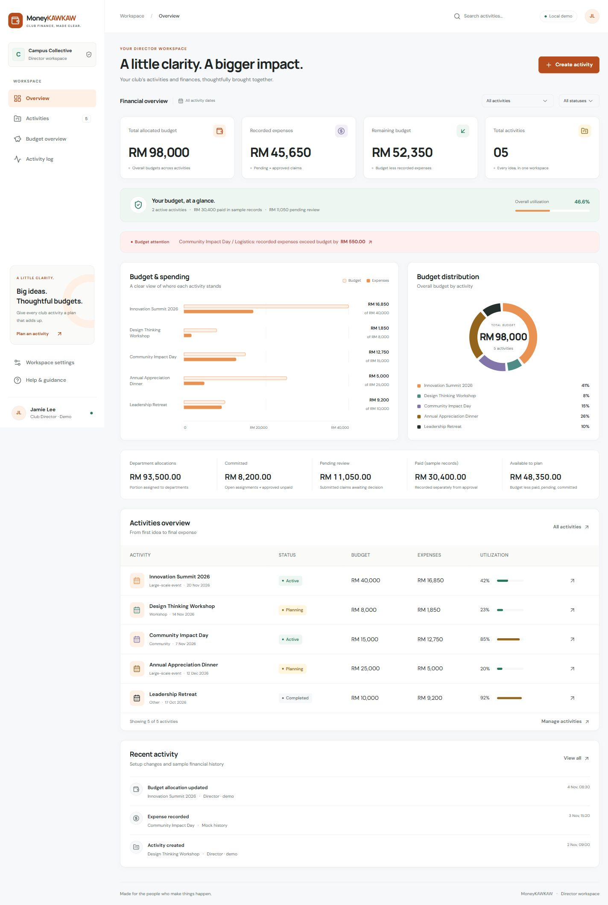
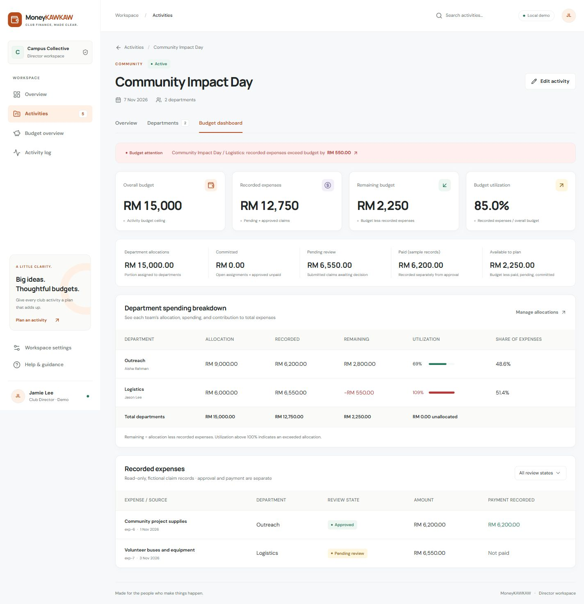
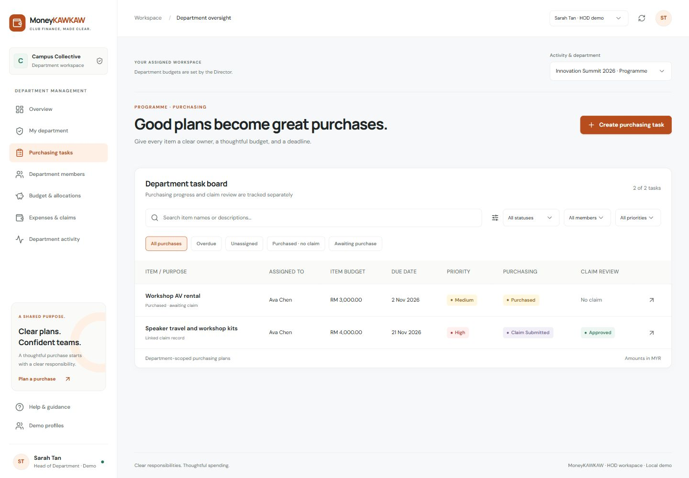
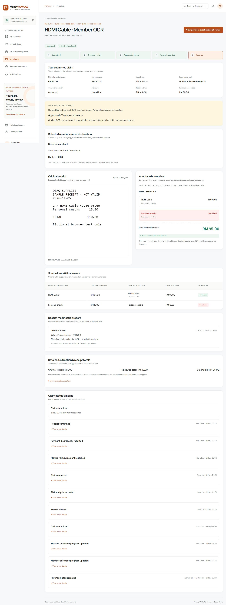
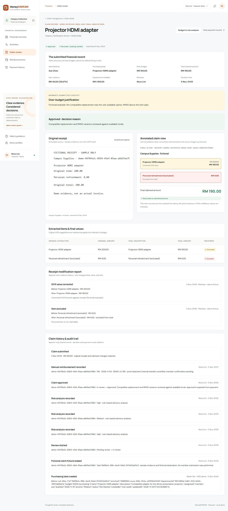
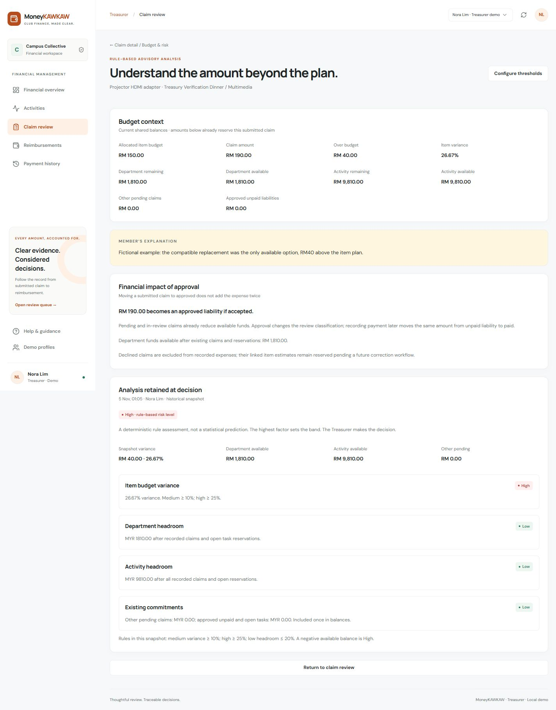
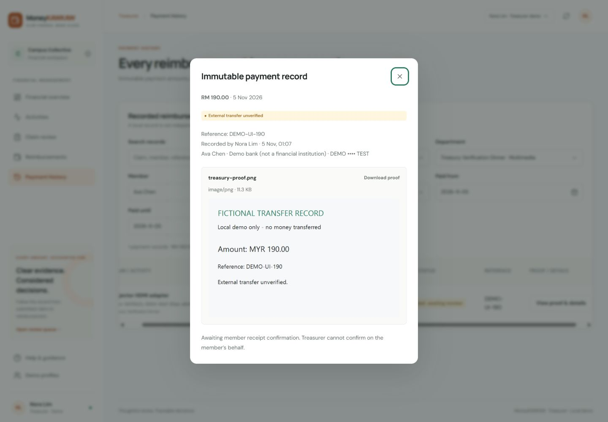
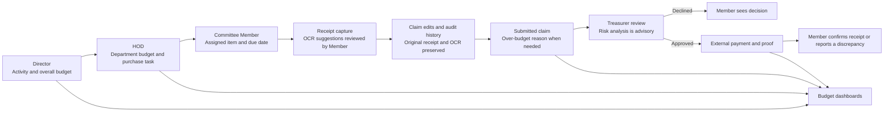
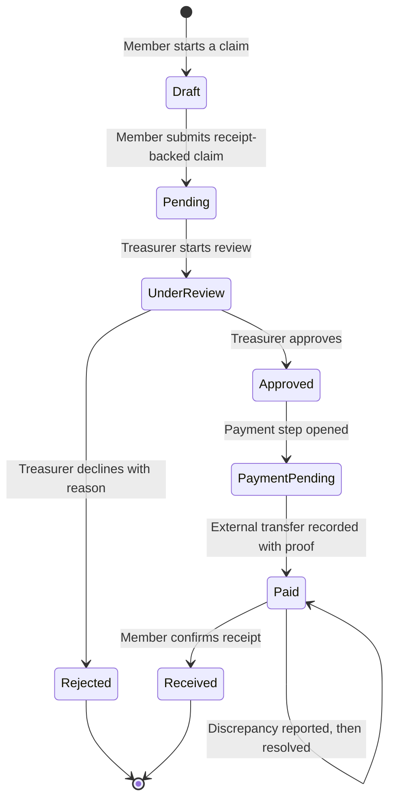
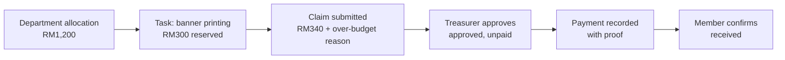

# MoneyKAWKAW

<p align="center">
  <b>A club budget and expense tracker that connects activity planning, department purchasing, receipt-backed claims, Treasurer review, and verified reimbursement.</b>
</p>

<p align="center">
  
  
  
  
  
  
</p>

<p align="center">
  <a href="https://moneykawkaw.pages.dev/">🌐 Live Deployment</a> ·
  <a href="#main-functions">📊 Main Functions</a> ·
  <a href="#local-development">🛠️ Run Locally</a> ·
  <a href="docs/supabase/README.md">🔐 Supabase Setup & Security</a> ·
  <a href="#project-materials">📁 Project Materials</a>
</p>

<p align="center">
  
</p>

---

## Table of Contents

- [AIROST Internship Project](#airost-internship-project)
- [Problem Statement](#problem-statement)
- [Introduction](#introduction)
- [Demo](#demo)
- [Screenshots](#screenshots)
- [Live Deployment](#live-deployment)
- [Main Functions](#main-functions)
- [Role Workflows](#role-workflows)
- [System Flow](#system-flow)
- [Claim Lifecycle](#claim-lifecycle)
- [Worked Example: A Department Purchase](#worked-example-a-department-purchase)
- [Architecture and Access Control](#architecture-and-access-control)
- [Frontend & Backend](#frontend-and-backend)
- [Technical Stack](#technical-stack)
- [Experimental Models](#experimental-models)
- [Local Development](#local-development)
- [Environment Variables](#environment-variables)
- [Cloud Deployment](#cloud-deployment)
- [Application Routes](#application-routes)
- [Project Structure](#project-structure)
- [Verification](#verification)
- [Project Materials](#project-materials)
- [Future Improvements](#future-improvements)
- [Team](#team)
- [Notes for Evaluators](#notes-for-evaluators)

---

## AIROST Internship Project

| Field | Details |
|---|---|
| Project name | MoneyKAWKAW |
| Project team | NJHL |
| Submission | AIROST Internship Project |
| Project type | Club budget, purchasing, and expense tracking web app |
| Repository contributor | [Wong Jia Hui](https://github.com/jiahui-1101) |

<!-- Add other confirmed team member names here if applicable. -->

## Problem Statement

A club event is planned months ahead, but its money moves in many small steps: a Director sets a budget, departments buy items with their own money, receipts arrive as photos in chat groups, and a Treasurer pays people back later. When these steps live in spreadsheets and messages, the same questions come up every time:

| Question | What usually goes wrong |
|---|---|
| How much of each department's budget is already used? | Spending is only known after receipts are collected, so overruns are found late. |
| Which purchases still have no claim? | Planned purchases and submitted claims are tracked in different places. |
| Is this receipt total correct? | Totals are typed by hand and edits leave no history. |
| Has this claim been paid? | "Approved" and "paid" are mixed up, and there is no proof of transfer. |
| Did the member actually receive the money? | There is no confirmation step, so disputes have no record. |

MoneyKAWKAW turns that scramble into one linked record: **budget → purchase task → receipt-backed claim → Treasurer decision → recorded payment → member confirmation**, with every total traceable to its source records.

## Introduction

Club activities often involve several departments, advance purchases, member reimbursement claims, and a fixed overall budget. MoneyKAWKAW keeps those steps in one auditable workspace. Each activity has a budget; each department receives an allocation; purchasing tasks connect to members, receipts, claims, decisions, and payment records.

The app supports Director, Treasurer, Head of Department (HOD), and Committee Member workflows. Role and activity/department scope are enforced by Supabase policies and authorized database operations, so a hidden button is never the only access check.

## Demo

Open the [MoneyKAWKAW live app](https://moneykawkaw.pages.dev/). Workspace sign-in is invite-only; credentials are not published here.

To explore without an invitation, run the app locally with <code>VITE_DATA_MODE=local</code> (see [Local Development](#local-development)) and open <code>/demo</code> to pick a fictional Director, HOD, Treasurer, or Member profile.

## Screenshots

| Director | HOD |
|---|---|
|  |  |
| Activity budget dashboard with department allocations and spending stages | Department purchasing tasks with budgets, due dates, and assignees |

| Committee Member | Treasurer |
|---|---|
|  |  |
| Receipt capture and OCR line review before submission | Claim evidence, corrections, and review decision |

| Advisory risk analysis | Payment proof |
|---|---|
|  |  |
| Contributing factors are shown; the Treasurer still decides | External transfer recorded with proof, separate from approval |

More screenshots, including mobile layouts, are in [docs/screenshots](docs/screenshots), [docs/hod/screenshots](docs/hod/screenshots), [docs/member/screenshots](docs/member/screenshots), and [docs/treasurer/screenshots](docs/treasurer/screenshots).

## Live Deployment

| Resource | Link | Notes |
|---|---|---|
| Web application | [moneykawkaw.pages.dev](https://moneykawkaw.pages.dev/) | Cloudflare Pages frontend. Invite-only workspace access. |
| Source code | [GitHub repository](https://github.com/jiahui-1101/MoneyKAWKAW) | React, TypeScript, and Supabase project. |
| Supabase setup | [Database, authentication, and security guide](docs/supabase/README.md) | Includes local setup and role/access boundaries. |

## Main Functions

- **Activity and budget setup:** Directors create activities, set an overall budget, create departments, assign department access, and review activity and organization-wide financial dashboards.
- **Department purchasing:** HODs manage only departments they are assigned to, create itemized purchasing tasks, set budgets and due dates, and assign work to eligible members.
- **Receipt-backed claims:** Members record purchases, upload or capture receipts, review OCR suggestions, correct or exclude lines with reasons, and submit the reconciled amount with any over-budget explanation.
- **Treasurer review and payment:** Treasurers review authorized claims, inspect evidence and audit history, analyze over-budget requests, approve or decline with a recorded decision, then separately record an external payment and its proof.
- **Member confirmation:** Members see claim and payment status, view proof for their own claim, report a discrepancy, and confirm receipt of payment.
- **Dashboards and traceability:** Activity, department, Treasurer, HOD, and Member views summarize budget stages and link totals back to the underlying tasks, claims, and payments.

## Role Workflows

### Director

- Create and update activities, dates, status, overall budgets, departments, and allocations.
- Explicitly grant HOD and Member access to activity departments.
- Track organization and activity budgets, recorded expenses, reservations, pending claims, utilization, and recent history.
- View financial summaries while claim details remain restricted to authorized claim participants and Treasurers.

### Treasurer

- See only activities for which Treasurer access is explicitly granted.
- Review a searchable claim queue and open original receipts, OCR output, corrections, exclusions, explanations, and claim history.
- Start a review, run an advisory over-budget analysis, and record an approval or decline with a reason where required.
- Access payout instructions at the authorized payment step; details are masked in normal views.
- Record an externally completed payment, attach proof, review payment history, and wait for the Member to confirm receipt.

Approval is a decision, not a payment. Recording a payment does not mark it received by the Member.

### Head of Department (HOD)

- Switch between explicitly assigned activities and departments.
- Create purchasing tasks, define item budgets and due dates, and assign eligible department members.
- Track task progress, department purchasing plans, allocated budget, and recorded spending.
- HODs cannot change the Director’s overall allocations, review or approve claims, or record reimbursements.

### Committee Member

- View personal activities, assigned purchasing work, and permitted department coordination details.
- Manage saved bank or Touch 'n Go payout instructions; values are masked and can be selected for a claim.
- Upload a receipt image or use camera capture, review on-device English OCR, correct line items, and keep excluded lines with reasons in the audit history.
- Submit a claim, follow its review and payment status, view the Treasurer’s proof, and confirm or dispute receipt.

## System Flow

1. The Director creates an activity, sets the overall budget, creates departments, and grants access.
2. The HOD creates a purchasing task with an item budget and deadline, then assigns a Member.
3. The Member buys the item, uploads or captures the receipt, reviews OCR, edits claim lines, and submits the claim.
4. The Treasurer reviews the original evidence and change history, then approves or declines. An over-budget risk analysis is advisory and shows its contributing factors.
5. After approval, the Treasurer separately records the external payment and uploads proof.
6. The Member confirms receipt or records a discrepancy. The activity history and financial totals update from linked records.



The same flow as a sequence, from budget setup to the Member's confirmation:

```mermaid
sequenceDiagram
    autonumber
    participant D as Director
    participant H as HOD
    participant M as Committee Member
    participant S as Supabase (RLS + RPCs)
    participant T as Treasurer
    D->>S: Create activity, overall budget, departments, access grants
    H->>S: Create purchase task with item budget and due date
    S-->>M: Task assigned (estimate reserved in department budget)
    M->>S: Upload receipt, review OCR lines, submit claim
    S->>S: Validate scope, amounts, and status; replace task estimate with claim amount
    T->>S: Start review, open evidence and history
    T->>S: Optional advisory over-budget analysis
    T->>S: Approve or decline with reason
    T->>S: Record external payment and upload proof
    S-->>M: Payment recorded with proof
    M->>S: Confirm receipt or report a discrepancy
    S-->>D: Dashboards recalculated from linked records
```

## Claim Lifecycle

Claim status changes are validated by the <code>transition_claim</code> database function and payment RPCs (see <code>supabase/migrations/</code>). Every change writes a row to the claim status history with the actor, time, and reason. In the interface, a rejected claim is shown as **Declined**.



| Rule | Enforced by |
|---|---|
| Only an independent Treasurer with activity access can review, approve, or decline; a Treasurer cannot review their own claim. | <code>transition_claim</code> |
| A decline needs a reason of at least 3 characters. | <code>transition_claim</code> |
| Payment can only be recorded for an approved claim in Payment Pending. | Payment recording RPC |
| Only the claimant can confirm receipt or report a discrepancy. | <code>transition_claim</code> and dispute RPC |
| A stale screen cannot overwrite a newer claim; the user is asked to refresh. | Expected <code>updated_at</code> check |

Recording a payment states that a manual external transfer was recorded; bank settlement is not independently verified by the app.

## Worked Example: A Department Purchase

The figures below are **illustrative** and show how the [budget rules](#budget-calculations) apply. They are not real club data.



| Step | Event | Department view |
|---|---|---|
| 1 | Director allocates RM1,200 of a RM5,000 activity budget to Logistics. | Remaining RM1,200 |
| 2 | HOD creates a banner-printing task with an item budget of RM300 and assigns a Member. | RM300 committed as an open reservation |
| 3 | Member buys the banner for RM340, uploads the receipt, reviews OCR lines, and explains the RM40 overrun. | Claim of RM340 replaces the RM300 estimate; recorded expenses RM340; remaining RM860 |
| 4 | Treasurer reviews the receipt, OCR output, and edit history, checks the advisory risk factors, and approves. | RM340 approved and still unpaid |
| 5 | Treasurer records the external transfer and uploads proof. | RM340 paid, awaiting Member confirmation |
| 6 | Member confirms receipt. | Claim closed as Received |

If the Treasurer had declined the claim at step 4, the RM340 would stay in history but leave recorded expenses, and the RM300 task reservation would be restored.

## Architecture and Access Control

- Supabase Auth identifies the signed-in user. PostgreSQL row-level security and scoped RPCs enforce role, activity, department, and record ownership on the server.
- Directors configure activity budgets and membership; HODs manage assigned departments; Members access their own claims and payment details; Treasurers access claims and payment instructions only within their explicit activity scope.
- Claim review, payment, and Member receipt confirmation are separate audited events.
- Original receipt files and OCR extraction are preserved. Corrections and excluded lines retain before/after values, actor, time, and reason.
- OCR is a review aid. Over-budget risk results are advisory; the Treasurer makes the approval decision.
- Payout details are payment instructions, not authorization to transfer funds. The app records an external transfer and its proof; it does not initiate bank or wallet payments.
- Dashboard figures are derived from linked activity, department, task, claim, and payment records. Client-submitted totals are not authoritative.
- Archived activities become read-only after reconciliation. Financial archive records remain linked to separately retained receipt files; full recovery also requires database and Storage backups.

### Budget Calculations

Amounts use integer minor units. Recorded expenses include pending, in-review, and approved claims; declined claims remain in history but are removed from recorded totals. Remaining budget is the budget minus recorded expenses. Committed amounts include open task reservations and approved unpaid claims. A submitted claim replaces its task estimate to prevent double counting; declining a claim restores that reservation.

Department allocations cannot exceed the activity budget. Lowering an activity budget below current allocations is rejected. Reducing an allocation below historical expenses preserves the records and shows the resulting overrun.

<a id="frontend-and-backend"></a>

## Frontend & Backend

The repository contains a React frontend and a Supabase-backed data layer; it does not use a separate application-server folder.

| Area | Location | Responsibility |
|---|---|---|
| Frontend application | <code>src/</code> | Role-based pages, dashboards, forms, receipt capture, charts, and navigation |
| Domain rules | <code>src/domain/</code> | Linked records, budget calculations, statuses, and setup validation |
| Data services | <code>src/services/</code> | Supabase repositories/RPC adapters and explicit local demo adapters |
| Database backend | <code>supabase/</code> | SQL migrations, functions, row-level security, and local configuration |
| Automated checks | <code>tests/</code> | Unit, permission, lifecycle, persistence, and integration coverage |

Supabase is the backend for authentication, PostgreSQL persistence, database functions, and access policies. The public frontend uses a publishable key; server-only credentials must never be placed in Vite variables or committed.

## Technical Stack

- **Frontend:** React 19, TypeScript, React Router, and Vite 7.
- **Database and authentication:** Supabase Auth and PostgreSQL with row-level security and RPCs.
- **Receipt capture:** Browser camera/file input and on-device English OCR with Tesseract.js.
- **Testing and linting:** Vitest, TypeScript, and Oxlint.
- **Hosting:** Cloudflare Pages static frontend with security headers emitted by the release build.

| Area | Choice |
|---|---|
| Framework | React 19, React Router 7 |
| Build | Vite 7, TypeScript 5.9 |
| Backend | Supabase (PostgreSQL, Auth, Storage, row-level security, RPCs); Supabase CLI 3 for local development |
| Receipt OCR | Tesseract.js 7 with English language data, running in the browser |
| Icons and fonts | lucide-react, DM Sans and Manrope variable fonts |
| Tests and linting | Vitest, Oxlint with React and JSX accessibility plugins |
| Hosting | Cloudflare Pages (static <code>dist/</code> build) |

## Experimental Models

The <code>ml/</code> folder holds offline experiments. They are **disabled in the production release build** and never authorize a financial operation.

| Folder | Experiment | Status |
|---|---|---|
| <code>ml/receipt/</code> | Fine-tuned multilingual DistilBERT that classifies OCR receipt rows | Optional local opt-in via <code>VITE_RECEIPT_MODEL</code>; deterministic parsing and database validation remain authoritative; Member review is mandatory |
| <code>ml/risk/</code> | LightGBM model of future budget pressure, trained on **synthetic** activity lifecycles | Not validated on real club outcomes; the deterministic advisory analysis is what Treasurers use |
| <code>ml/assistant/</code> | Local Qwen financial assistant using bounded, read-only, scope-checked database context | Local experiment; requires explicit opt-in via <code>VITE_QWEN_MODEL</code> |

Each folder's README explains how to reproduce, evaluate, and the limits of the experiment.

## Local Development

Requirements: Node.js and npm. Vite 7 needs Node.js 20.19+ or 22.12+. The Supabase integration tests also need Docker for the local Supabase stack.

```bash
git clone https://github.com/jiahui-1101/MoneyKAWKAW.git
cd MoneyKAWKAW
cp .env.example .env.local   # local demo mode by default
```

From the repository root:

1. Install dependencies with <code>npm ci</code>.
2. Start the app with <code>npm run dev -- --port 5186</code>.
3. Open the localhost URL printed by Vite.

Useful commands:

| Command | Purpose |
|---|---|
| <code>npm test</code> | Run unit and local application tests; excludes the separate Supabase integration suite. |
| <code>npm run lint</code> | Lint source and tests with Oxlint. |
| <code>npm run typecheck</code> | Run TypeScript without emitting files. |
| <code>npm run build</code> | Typecheck and create a standard Vite build. |
| <code>npm run build:release</code> | Create the constrained production candidate for the authorized hosted Supabase project. |
| <code>npm run test:supabase</code> | Run integration tests against the local Supabase/Docker environment. |

For the database, authentication, seed data, and local Supabase test setup, follow [docs/supabase/README.md](docs/supabase/README.md). Do not use a database reset command against a hosted project.

## Environment Variables

See [.env.example](.env.example) for the variable names and local defaults.

| Variable | Purpose |
|---|---|
| <code>VITE_DATA_MODE</code> | Select the explicit local demo or Supabase data source. |
| <code>VITE_SUPABASE_URL</code> | Supabase project URL used by the client. |
| <code>VITE_SUPABASE_PUBLISHABLE_KEY</code> | Public Supabase publishable/anonymous key for the browser. Never use a server secret here. |
| <code>VITE_LOCAL_TEST_LOGIN</code> | Local-only authentication option; production release disables it. |
| <code>VITE_RECEIPT_MODEL</code>, <code>VITE_PRESSURE_MODEL</code>, <code>VITE_QWEN_MODEL</code> | Optional experimental features; production release forces these off. |

Google OAuth client secrets belong in Supabase provider configuration and must not be exposed to the browser or committed to Git. Use fictional payout details in local demo data.

## Cloud Deployment

The public frontend is hosted on [Cloudflare Pages](https://moneykawkaw.pages.dev/).

For a reviewed production candidate:

1. Set <code>VITE_SUPABASE_URL</code> to the authorized HTTPS Supabase project.
2. Set <code>VITE_SUPABASE_PUBLISHABLE_KEY</code> to its public publishable key.
3. Build with <code>npm run build:release</code>.
4. Publish the generated <code>dist/</code> directory to the existing Pages project.
5. Configure the exact HTTPS origin in Supabase Auth redirect allowlists and verify the invited-user sign-in flow.

The release build forces Supabase mode, disables synthetic login and experimental models, copies the supported OCR assets, emits a Content Security Policy and other security headers, and redirects temporary hosted QA routes. Keep secrets out of the static build and repository. Database migrations are reviewed and applied separately from the frontend deployment.

## Application Routes

| Route | Page |
|---|---|
| <code>/</code> | Redirect to the selected role overview |
| <code>/director</code> | Organization overview and budget dashboard |
| <code>/director/activities</code> | Searchable activity portfolio |
| <code>/director/activities/new</code> | Create an activity |
| <code>/director/activities/:id</code> | Activity overview |
| <code>/director/activities/:id/edit</code> | Edit activity details |
| <code>/director/activities/:id/departments</code> | Department setup and allocations |
| <code>/director/activities/:id/budget</code> | Activity budget dashboard |
| <code>/director/activities/:id/map</code> | Activity Money Map |
| <code>/director/budgets</code> | Organization financial breakdown |
| <code>/director/history</code> | Searchable change history |
| <code>/director/settings</code> | Workspace timezone, thresholds, and demo settings |
| <code>/hod</code> | HOD overview |
| <code>/hod/activities/:activityId/departments/:departmentId</code> | Scoped department workspace |
| <code>/treasurer</code> | Treasurer financial overview |
| <code>/treasurer/activities</code> | Authorized activity finances |
| <code>/treasurer/activities/:id</code> | Activity finances and Money Map |
| <code>/treasurer/claims</code> | Searchable claim review queue |
| <code>/treasurer/claims/:id</code> | Claim evidence and review decisions |
| <code>/treasurer/claims/:id/risk</code> | Advisory over-budget analysis |
| <code>/treasurer/claims/:id/reimburse</code> | Approved-only manual payment step |
| <code>/treasurer/reimbursements</code> | Approved, unpaid claims |
| <code>/treasurer/history</code> | Payment history and proof |
| <code>/member</code> | Personal overview |
| <code>/member/activities</code> | Assigned activity/department workspaces |
| <code>/member/activities/:activityId/departments/:departmentId</code> | Scoped roster and purchasing plans |
| <code>/member/tasks</code> | Personal tasks and department coordination |
| <code>/member/tasks/:id</code> | Owned purchase progress or read-only coordination |
| <code>/member/drafts/:id</code> | Receipt and claim submission |
| <code>/member/claims</code> | Own drafts and submitted claims |
| <code>/member/claims/:id</code> | Own evidence, review, and timeline |
| <code>/member/claims/:id/payment</code> | Own payment proof and receipt confirmation |
| <code>/member/accounts</code> | Own saved payout instructions |
| <code>/member/notifications</code> | Personal notifications |
| <code>/demo</code> | Explicit local demo profile selection |

## Project Structure

- <code>src/components/</code> — shared UI, charts, receipt and budget components.
- <code>src/pages/</code> — Director, HOD, Treasurer, and Member workspaces.
- <code>src/services/supabase/</code> — Supabase authentication, repository, and authorized RPC access.
- <code>src/services/</code> — explicit demo seed and local persistence adapters.
- <code>src/domain/</code> — models, budget rules, and pure calculations.
- <code>supabase/migrations/</code> — ordered schema, policy, and database-function migrations.
- <code>tests/</code> — unit and workflow tests.
- <code>docs/</code> — setup and role-specific implementation guides.

```text
MoneyKAWKAW/
├── src/
│   ├── App.tsx              route table for all role workspaces
│   ├── components/          shared UI, charts, receipt, budget, and role shells
│   ├── pages/               Director pages, plus hod/, member/, treasurer/
│   ├── domain/              models, budget rules, risk, receipt, and access logic
│   ├── services/            demo adapters, OCR, validation, and Supabase access
│   │   └── supabase/        authentication, repositories, and RPC adapters
│   ├── context/             session and workspace state
│   └── styles/              global styles
├── supabase/
│   └── migrations/          ordered schema, RLS policies, storage, and RPCs
├── tests/                   unit, permission, lifecycle, and Supabase integration tests
├── scripts/                 OCR preparation, release build, seeding, and test helpers
├── ml/                      offline model experiments (receipt, risk, assistant)
├── public/                  favicon, OCR assets, and model runtimes
└── docs/
    ├── screenshots/         Director screenshots
    ├── hod/ member/ treasurer/   role guides, verification notes, screenshots
    └── supabase/            database, authentication, and security setup
```

## Verification

The current project has unit coverage for role scoping, finance calculations, review/payment lifecycle, receipt history, and dashboard behavior. Run the commands in [Local Development](#local-development) before submitting a change. Supabase integration tests use an isolated local project; do not point test/reset scripts at hosted data.

The release build is designed to reject model weights and environment files. Experimental models are disabled in the static release.

Role-specific verification notes are in [docs/VERIFICATION.md](docs/VERIFICATION.md), [docs/hod/VERIFICATION.md](docs/hod/VERIFICATION.md), [docs/member/VERIFICATION.md](docs/member/VERIFICATION.md), and [docs/treasurer/VERIFICATION.md](docs/treasurer/VERIFICATION.md).

## Project Materials

| Material | Link | Status |
|---|---|---|
| Live app | [moneykawkaw.pages.dev](https://moneykawkaw.pages.dev/) | Invite-only |
| Supabase setup and security | [docs/supabase/README.md](docs/supabase/README.md) | Ready |
| HOD workspace guide | [docs/hod/README.md](docs/hod/README.md) | Ready |
| Member workspace guide | [docs/member/README.md](docs/member/README.md) | Ready |
| Treasurer workspace guide | [docs/treasurer/README.md](docs/treasurer/README.md) | Ready |
| Verification notes | [docs/VERIFICATION.md](docs/VERIFICATION.md) | Ready |
| Commit log notes | [docs/COMMITS.md](docs/COMMITS.md) | Ready |
| Model experiments | [ml/receipt](ml/receipt/README.md), [ml/risk](ml/risk/README.md), [ml/assistant](ml/assistant/README.md) | Experimental |

## Future Improvements

These are possible next steps, not features in the current release.

1. **Payment integration:** connect to a bank or e-wallet API so transfers are verified by the provider instead of manually recorded.
2. **Multilingual OCR:** extend on-device OCR beyond English, keeping Member review as the safety gate.
3. **Validated risk model:** train and evaluate the budget-pressure model on real, consented club history before it informs any review.
4. **Notifications:** send email or push reminders for due purchase tasks, pending reviews, and unconfirmed payments.
5. **Reporting:** export reconciled activity reports for club committees and auditors.

## Team

**Project team:** NJHL
**Repository contributor:** [Wong Jia Hui](https://github.com/jiahui-1101)

<!-- Add any additional confirmed team members and their contributions here. -->

### Team Contributions

> Roles below are taken from the commit history. Please review them and add any other confirmed members before submission.

| Team member | Role | Contributions evidenced in the repository |
|---|---|---|
| **Wong Jia Hui** | Developer | Director, HOD, Treasurer, and Member workspaces; Supabase schema, RLS, and RPCs; receipt OCR; dashboards; model experiments; Cloudflare deployment; documentation |

## Notes for Evaluators

- The deployed workspace uses invite-only sign-in. Do not publish or share account credentials in this README.
- Local demo profiles and fixtures are fictional and are not production identities or financial data.
- English OCR suggestions must be reviewed by the Member before submission; OCR does not decide what is claimable.
- Risk analysis is deterministic and advisory. It presents contributing factors but does not approve a claim.
- Reimbursements are manually recorded after an external transfer. There is no bank or Touch 'n Go payment integration.
- Payout details are masked and scoped. Use fictional payment details in local demo mode.

MoneyKAWKAW implements the full claim loop end to end:

```text
Activity budget
-> department allocation
-> purchase task (estimate reserved)
-> receipt upload + Member-reviewed OCR
-> submitted claim (estimate replaced by actual amount)
-> Treasurer review + advisory risk analysis
-> approve or decline
-> manually recorded external payment + proof
-> Member confirms receipt or reports a discrepancy
-> dashboards derived from linked records
```
